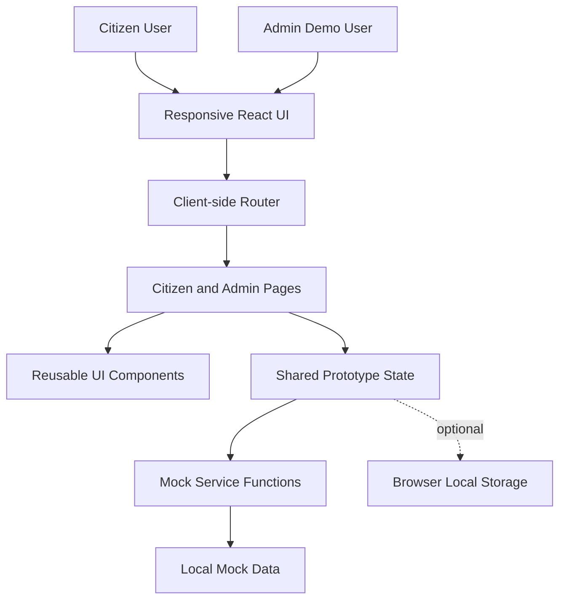
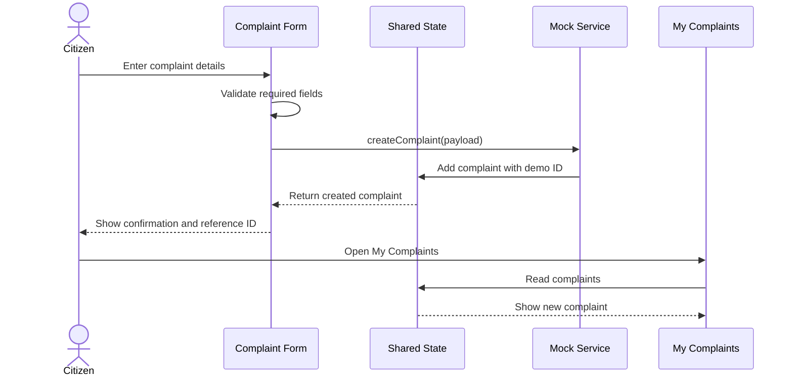
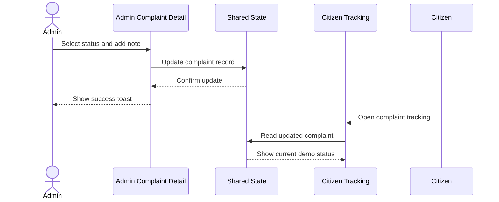

# Jal Seva — System Architecture
## Prototype Architecture Specification

**Project:** जल सेवा (Jal Seva) — Water Supply Management App  
**Document:** Architecture MD  
**Version:** 1.0  
**Date:** October 2026  
**Scope:** College-level clickable prototype only  
**Architecture style:** Frontend-first, modular single-page web application  
**Status:** Proposed design; no production integrations required

---

## 1. Purpose

This document defines the proposed software architecture for the Jal Seva prototype. It complements:

- `Jal_Seva_Prototype_PRD.md` — product requirements and feature scope.
- `Jal_Seva_Design_Specification.md` — screens, visual system, components, and interactions.

The architecture should support a clear citizen journey and a basic admin workflow using mock data. It must be easy to build, demonstrate, and extend later.

## 2. Architecture Principles

1. **Prototype first:** Build only what is required to demonstrate the concept.
2. **Frontend-first:** Do not require a production backend for the first demo.
3. **Modular UI:** Separate pages, reusable components, mock data, and state logic.
4. **Shared demo state:** Citizen and admin screens must use the same in-memory data source so admin updates appear in citizen tracking.
5. **Clear simulation:** Never imply that a demo complaint, bill payment, tanker request, schedule, or notice is connected to a real public service.
6. **Upgrade-friendly:** Keep data access and business logic separated enough to allow a future backend.
7. **Responsive:** Support mobile, tablet, and desktop layouts.

## 3. High-Level Architecture



### Component responsibilities

- **Responsive React UI:** Presents the app on mobile and desktop.
- **Client-side router:** Switches between citizen and admin screens without full page reloads.
- **Pages:** Implement screen-level layout and user journeys.
- **Reusable components:** Provide shared cards, forms, navigation, badges, modals, and toasts.
- **Shared prototype state:** Keeps complaint, schedule, notice, bill, and tanker-request views consistent.
- **Mock service functions:** Simulate submit, update, list, and detail operations.
- **Local mock data:** Supplies fictional example records.
- **Optional local storage:** Can retain non-sensitive demo edits across refreshes; not required.

## 4. Recommended Technology Stack

| Layer | Recommendation | Purpose |
|---|---|---|
| Frontend | React | Build interactive screens and reusable components |
| Build tool | Vite | Fast local development and prototype build |
| Language | JavaScript or TypeScript | Application logic |
| Styling | Tailwind CSS or CSS modules | Responsive design and design tokens |
| Routing | React Router | Citizen/admin page navigation |
| Icons | Lucide React | Consistent UI icons |
| State | React Context + `useReducer`, or a small state store | Shared mock state |
| Data | JavaScript/JSON mock records | Fictional prototype content |
| Persistence | Browser local storage (optional) | Retain demo state on the same browser |
| Testing | Manual checklist; optionally Vitest/React Testing Library | Validate key interactions |

This is a recommendation for the prototype, not a requirement to use every library.

## 5. Application Modules

### 5.1 Shared layout module
Responsibilities:
- Header, logo, page container, navigation.
- Citizen bottom navigation.
- Admin sidebar or mobile drawer.
- Responsive breakpoints.
- Persistent prototype-data banner.

### 5.2 Citizen module
Screens:
- Welcome / demo entry.
- Home dashboard.
- Water schedule.
- New complaint.
- My complaints and complaint details.
- Bills and payments.
- Tanker request.
- Notices.
- Profile / demo account.

### 5.3 Admin module
Screens:
- Admin demo entry.
- Overview dashboard.
- Complaint list and detail.
- Tanker requests.
- Water schedule editor.
- Notice editor.

Admin operations are simulated locally. There is no real account security in this prototype.

### 5.4 Mock data module
Owns the sample records for:
- Demo citizen profile.
- Water schedules.
- Complaints.
- Bills.
- Tanker requests.
- Notices.

### 5.5 Mock service module
Expose functions such as:
- `getSchedules(filters)`
- `getComplaints()`
- `getComplaintById(id)`
- `createComplaint(payload)`
- `updateComplaint(id, changes)`
- `getBills()`
- `createTankerRequest(payload)`
- `getTankerRequests()`
- `getNotices()`
- `saveSchedule(payload)`
- `saveNotice(payload)`

These functions operate on client-side state or local mock data. They do not make network calls.

## 6. Routing Architecture

Suggested routes:

| Route | Screen | Access in prototype |
|---|---|---|
| `/` | Welcome | Public |
| `/citizen` | Citizen dashboard | Demo citizen |
| `/schedule` | Water schedule | Demo citizen |
| `/complaints/new` | New complaint | Demo citizen |
| `/complaints` | My complaints | Demo citizen |
| `/complaints/:id` | Complaint details | Demo citizen |
| `/bills` | Bills & payments | Demo citizen |
| `/tanker-request` | New tanker request | Demo citizen |
| `/notices` | Notices | Public/demo |
| `/profile` | Demo profile | Demo citizen |
| `/admin` | Admin dashboard | Admin demo |
| `/admin/complaints` | Admin complaints | Admin demo |
| `/admin/complaints/:id` | Admin complaint details | Admin demo |
| `/admin/tanker-requests` | Admin tanker requests | Admin demo |
| `/admin/schedules` | Manage sample schedules | Admin demo |
| `/admin/notices` | Manage sample notices | Admin demo |

For the prototype, route access is only a user-experience convention. It is not a security boundary.

## 7. State Management

Use one shared state container for records that are edited from more than one screen.

Suggested state shape:

```js
{
  citizen: {},
  schedules: [],
  complaints: [],
  bills: [],
  tankerRequests: [],
  notices: []
}
```

### State rules
- Citizen and admin pages read from the same state.
- Submitting a complaint adds a new complaint record.
- Each new record receives a unique demo ID.
- Updating complaint status updates the same record in the shared state.
- Schedule and notice edits update local state.
- Forms show a success message after a successful state update.
- If local storage is used, load initial demo records once and persist only non-sensitive demo data.
- Include a reset-demo-data action if persistent edits may affect future presentations.

## 8. Data Flow

### 8.1 Complaint submission



### 8.2 Admin status update



### 8.3 Payment action

1. Citizen opens the sample bill.
2. Citizen selects “Pay Now.”
3. UI opens a demo-only modal.
4. No payment API is called and no credentials are collected.

### 8.4 Tanker request

1. Citizen fills out the request form.
2. The form validates required fields.
3. A mock service creates a request with a demo ID.
4. Confirmation and status appear in the citizen UI and admin request list.
5. No real tanker is dispatched.

## 9. Prototype Data Model

All data is fictional.

### Citizen
```ts
type Citizen = {
  id: string;
  name: string;
  demoCustomerNumber: string;
  area: string;
  addressLabel: string;
};
```

### WaterSchedule
```ts
type WaterSchedule = {
  id: string;
  area: string;
  date: string;
  startTime: string;
  endTime: string;
  status: "Scheduled" | "Delayed" | "Interrupted" | "Completed";
  notice?: string;
};
```

### Complaint
```ts
type Complaint = {
  id: string;
  category: "Leakage" | "LowPressure" | "DirtyWater" | "NoSupply" | "Other";
  area: string;
  address: string;
  description: string;
  photoPreview?: string;
  createdAt: string;
  status: "Submitted" | "UnderReview" | "Assigned" | "InProgress" | "Resolved" | "Rejected";
  staffNote?: string;
};
```

### Bill
```ts
type Bill = {
  id: string;
  demoCustomerNumber: string;
  billingPeriod: string;
  amount: number;
  dueDate: string;
  paymentStatus: "Paid" | "Pending";
};
```

### TankerRequest
```ts
type TankerRequest = {
  id: string;
  area: string;
  address: string;
  reason: string;
  preferredDate?: string;
  createdAt: string;
  status: "Received" | "UnderReview" | "ApprovedDemo" | "CompletedDemo" | "Rejected";
};
```

### Notice
```ts
type Notice = {
  id: string;
  title: string;
  area: string;
  type: "Maintenance" | "Interruption" | "Restoration" | "General";
  message: string;
  date: string;
};
```

## 10. Suggested Project Structure

```text
jal-seva/
├── public/
│   └── logo.svg
├── src/
│   ├── app/
│   │   ├── App.jsx
│   │   └── routes.jsx
│   ├── components/
│   │   ├── common/
│   │   ├── layout/
│   │   ├── citizen/
│   │   └── admin/
│   ├── pages/
│   │   ├── citizen/
│   │   └── admin/
│   ├── state/
│   │   ├── AppState.jsx
│   │   └── appReducer.js
│   ├── services/
│   │   └── mockApi.js
│   ├── data/
│   │   └── mockData.js
│   ├── styles/
│   │   ├── tokens.css
│   │   └── global.css
│   └── main.jsx
├── package.json
└── README.md
```

Keep the structure lightweight; avoid creating layers that do not add value to this prototype.

## 11. Error and Empty-State Handling

- Invalid form: show inline messages; do not add a record.
- Missing complaint ID: show “Complaint not found” and a return action.
- Empty complaint list: show a friendly message and a register-complaint action.
- No schedule for selected area/date: show a sample-data empty state.
- Local-storage failure: fall back to in-memory state where feasible.
- Save/update failure in UI simulation: show an error message and preserve the form values.
- Never show fake “live connection” or “server synced” indicators.

## 12. Security, Privacy, and Demo Boundaries

For the prototype:
- Use fictional names, customer IDs, addresses, bills, and phone placeholders.
- Do not collect real OTPs, passwords, UPI PINs, card details, or identity documents.
- Do not store sensitive user data.
- Label all records and actions as demo/sample.
- Do not represent client-side route checks as real access control.
- Do not claim that a complaint has reached a municipal office.
- Do not claim that payment has been made or a tanker dispatched.

### Production note
If the project is later upgraded, real users and public-service data will require a secure backend, server-side authorization, validation, audit logs, backups, appropriate privacy controls, and official integration approval. Those items are **not part of this prototype implementation**.

## 13. Future Production Architecture — Not for Current Scope

A future version could introduce:

- React or native mobile client.
- Backend API (for example, Node.js + Express).
- Relational database (for example, PostgreSQL).
- Server-side authentication and role-based authorization.
- Official municipal water-supply data integration.
- Payment gateway integration.
- SMS/push notification provider.
- Audit logging and monitoring.

Do not implement these future components now unless the project scope is explicitly expanded.

## 14. Architecture Acceptance Checklist

- [ ] Citizen and admin screens share the same prototype state.
- [ ] All pages are reachable through the client-side router.
- [ ] Complaint creation produces a unique demo ID.
- [ ] Admin status changes appear in citizen tracking.
- [ ] Tanker requests appear in the relevant demo list.
- [ ] Schedule and notice edits update the local UI state.
- [ ] Payment interactions never call a payment service.
- [ ] No external municipal API is required.
- [ ] All records are fictional and clearly labelled.
- [ ] Responsive layouts work on mobile and desktop.
- [ ] App can be demonstrated without backend credentials or network integrations.

## 15. Final Recommendation

Build Jal Seva as a **React + Vite frontend with shared client-side state and mock service functions**. This is sufficient to demonstrate the primary citizen journey and admin workflow while keeping development effort low.

The architecture should make the prototype feel interactive and coherent without pretending to provide real water-supply services.
