# 💧 जल सेवा (Jal Seva) — Urban Water Supply Management Platform

> **पुणे महानगरपालिका — पाणी पुरवठा व्यवस्थापन आणि नागरिक सेवा ॲप**  
> *A high-fidelity, bilingual digital civic utility platform simulating smart urban water distribution, ward-wise scheduling, complaint redressal, emergency tanker dispatch, and bill management.*

[](https://github.com/swapnil3104/Jal-Seva-Water-Supply-Management-App-Prototype)
[](https://react.dev/)
[](https://vitejs.dev/)
[](https://tailwindcss.com/)
[](https://capacitorjs.com/)
[](#-bilingual-civic-accessibility-मराठी--english)
[](#-license--attribution)

---

## 📌 Executive Summary

**जल सेवा (Jal Seva)** is a modern digital utility platform engineered for Indian municipal corporations, specifically modeled around **Pune Municipal Corporation (PMC)**. It bridges the critical communication gap between urban citizens and municipal water supply engineers.

Urban citizens often face unpredictable water supply timings, variable pipeline pressure, delayed leak repairs, and unorganized emergency tanker deliveries. **जल सेवा** provides a unified, transparent digital touchpoint where citizens can view live ward schedules, register grievances with photo and GPS landmark details, track redressal progress across 4 stages, simulate bill payments, and request emergency water tankers. 

Simultaneously, municipal water department officers have access to a synchronized **Control Room Dashboard** to monitor ward KPIs, assign maintenance teams, update complaint statuses, and dispatch tanker vehicles.

> [!NOTE]  
> **Simulation Disclaimer**: This application is a fully functional client-side interactive demonstration. All consumer IDs, water meter telemetry, complaints, billing invoices, and tanker dispatch queues are safely maintained in local state and `localStorage`. No actual municipal servers or monetary banking gateways are contacted.

---

## 📸 Web Application Screenshots & Visual Tour

### 1. App Initialization & Boot Sequence
A smart-city loading sequence featuring realistic IoT water grid telemetry, connection to ward sensors, and seamless entrance.

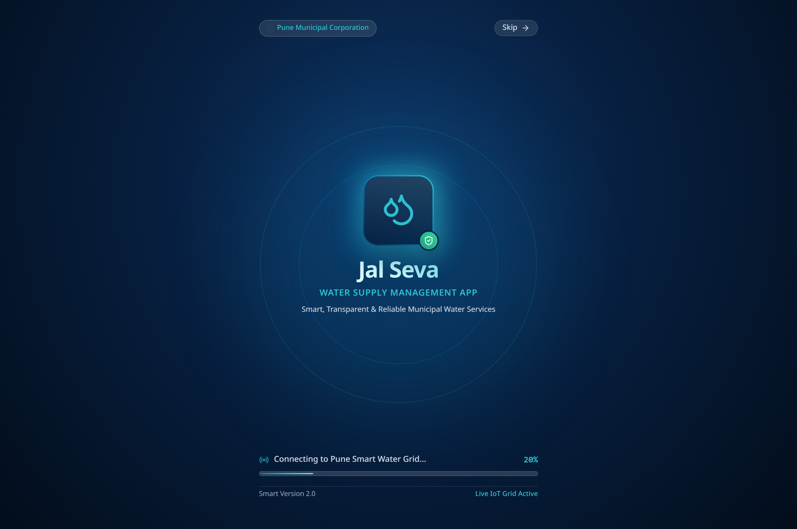

---

### 2. Portal Welcome & Experience Gateway (`/`)
Citizens and municipal administrators can select their preferred portal experience with quick access to the bilingual toggle (मराठी / English) and feature highlights.

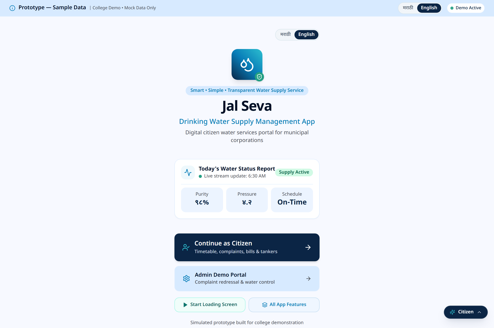

---

### 3. Citizen Smart Dashboard (`/citizen`)
The central command center for citizens. Features live water supply status indicators (active, pressure level, duration countdown), quick action cards, emergency municipal notice ribbons, and active complaint previews.

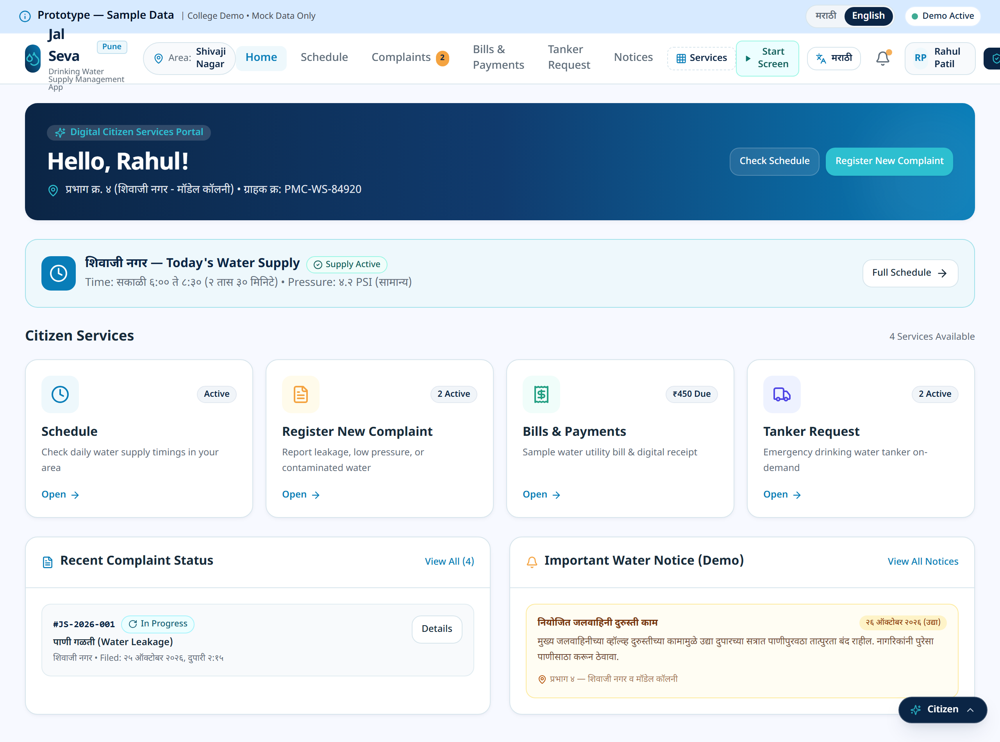

---

### 4. Ward-Wise Water Supply Schedule (`/schedule`)
Real-time schedule timetable showing ward-wise water release timings (e.g., शिवाजी नगर, कोथरूड, हडपसर, औंध), current pressure levels (उच्च, मध्यम, कमी), valve status, and duration counters.

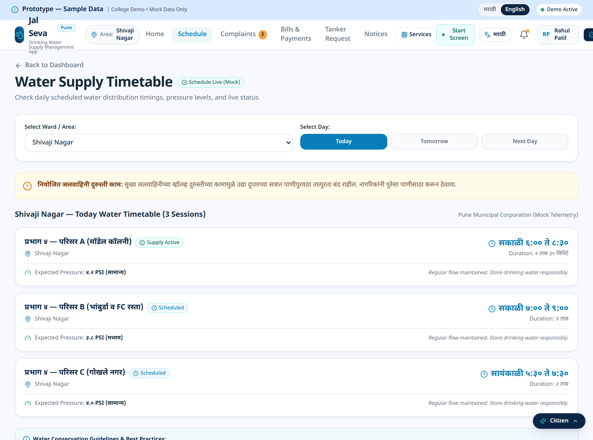

---

### 5. Citizen Grievance & Complaint Registration (`/complaints/new`)
Step-by-step grievance submission form. Citizens select grievance categories (पाणी गळती / Pipe Leakage, कमी दाब / Low Pressure, दूषित पाणी / Contaminated Water, अनियमित वेळ / Irregular Timetable, मीटर बिघाड / Meter Fault), add locality landmarks, and attach issue descriptions.

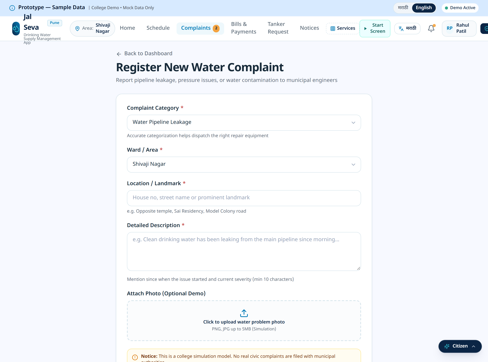

---

### 6. Real-Time Complaint Redressal Timeline (`/complaints/:id`)
Interactive 4-stage tracking timeline reflecting municipal processing in real time:
1. **तक्रार दाखल (Complaint Submitted)**
2. **तपासणी सुरू (Under Inspection)**
3. **दुरुस्ती काम प्रगतीत (Repair Work in Progress)**
4. **निकाली (Resolved)**

Includes official municipal engineer response notes, priority badges, and inspector contacts.

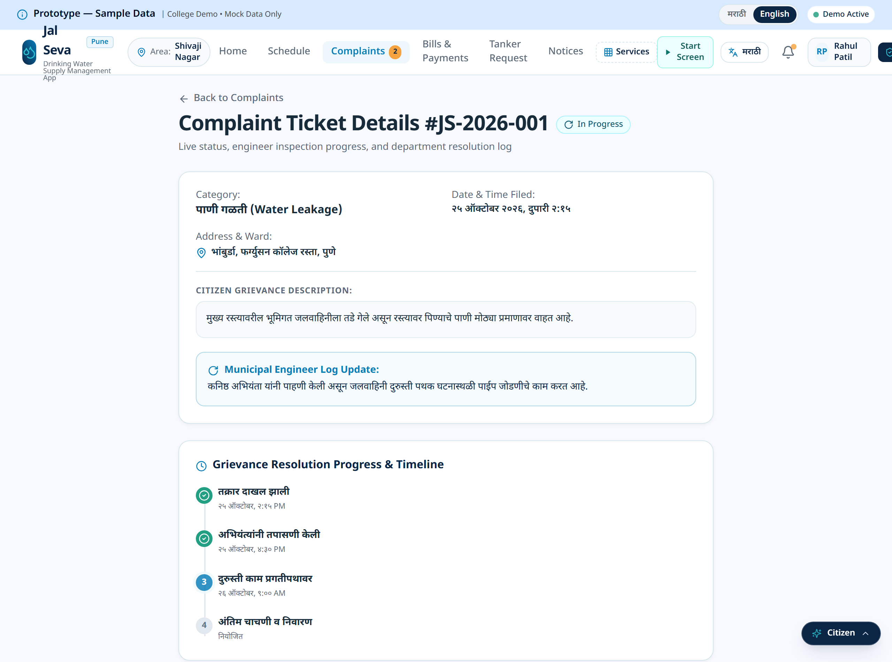

---

### 7. Utility Bills & Payment Simulation (`/bills`)
Complete billing history showing consumption records in kiloliters (kL), meter readings, tariff breakdown, due date warnings, and a simulated safe mock checkout with downloadable payment receipts.

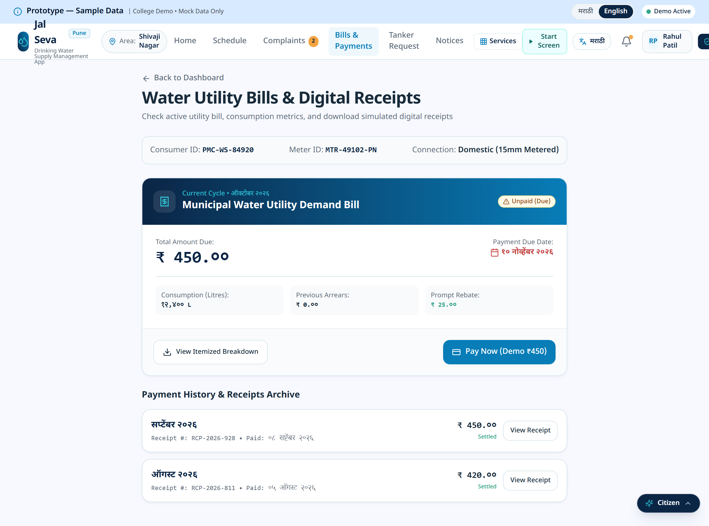

---

### 8. Emergency Water Tanker Dispatch Request (`/tanker-request`)
Direct emergency tanker requisition system for water shortages, pipeline breakdowns, or residential society requirements. Shows estimated arrival windows and allocation status.

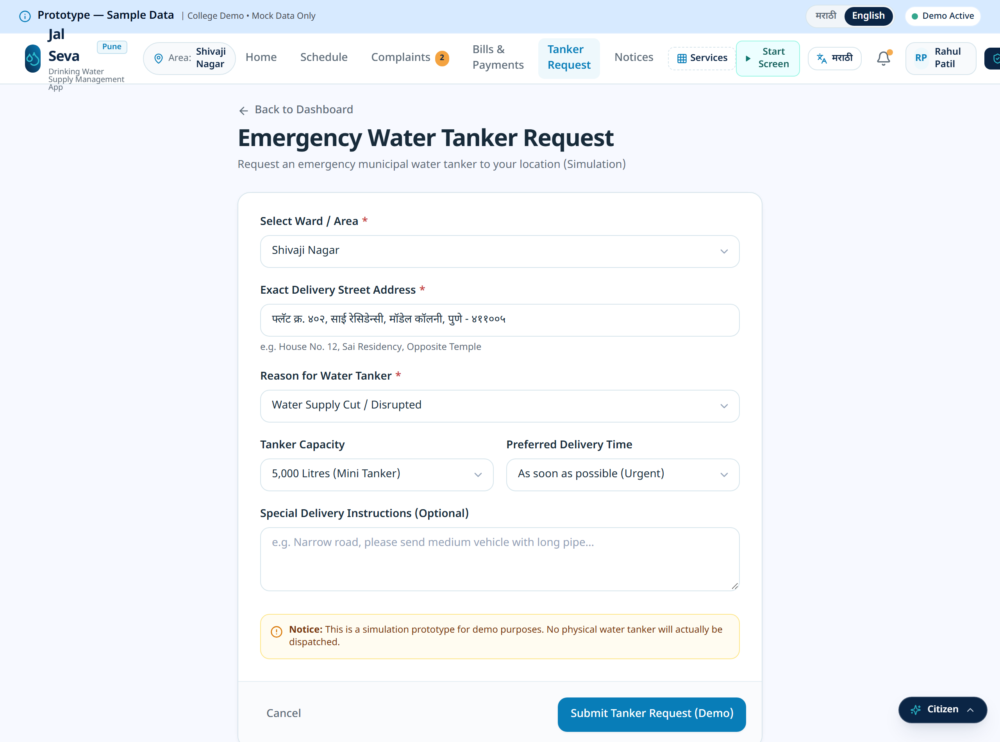

---

### 9. Municipal Control Room & Admin Dashboard (`/admin`)
Executive dashboard for municipal water board engineers showing total active complaints, resolved tickets, pending emergency tankers, ward distribution status, and rapid action shortcuts.

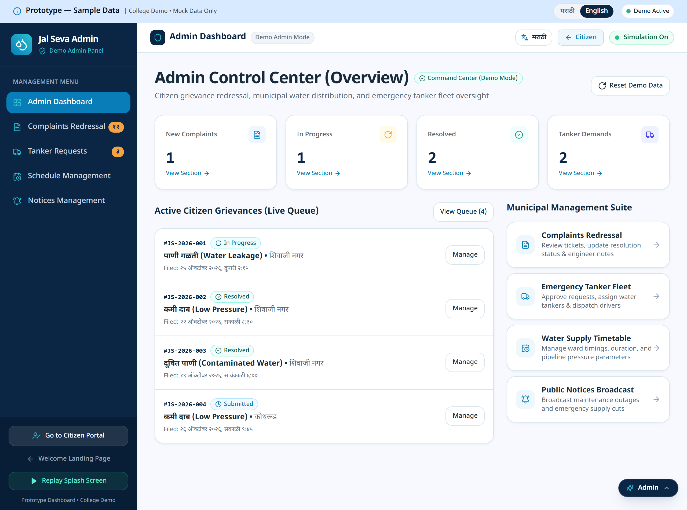

---

### 10. Admin Ticket Management & Resolution Engine (`/admin/complaints`)
Allows water department officers to filter grievances by ward and urgency, reassign technicians, append official department inspection notes, and transition statuses with instant cross-tab live synchronization.

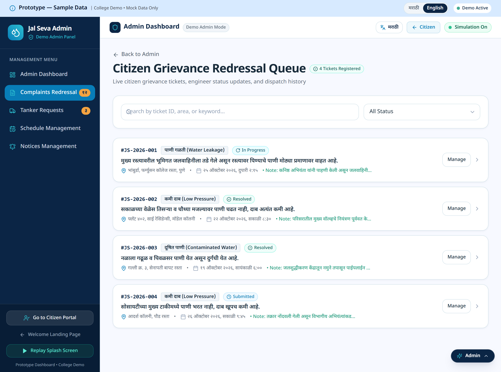

---

### 11. Admin Emergency Tanker Dispatcher (`/admin/tanker-requests`)
Fleet allocation tool for managing municipal water tanker vehicles, assigning drivers, updating dispatch timestamps, and marking delivery completions.

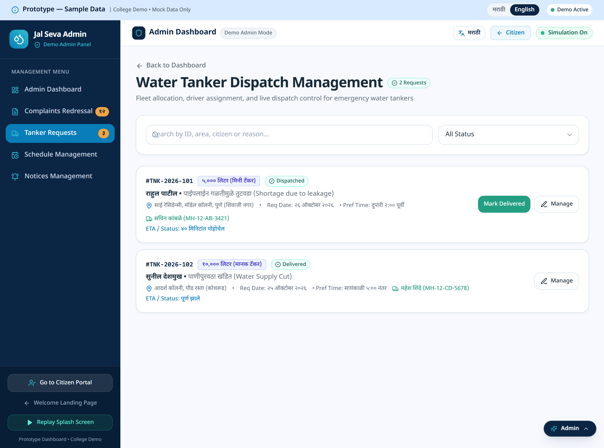

---

### 12. Mobile Responsive Experience & Native Android App
Optimized for mobile viewports (360px - 480px) and native Android deployment via Capacitor, including touch targets, bottom navigation bar, and offline local cache.

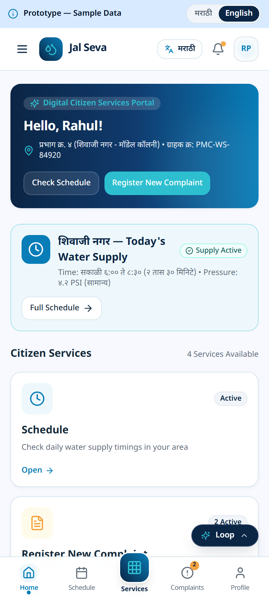

---

## 🌟 Key Capabilities & Features

### 🧑‍💼 Citizen Features
| Feature | Route | Description |
| :--- | :--- | :--- |
| **Live Supply Status** | `/citizen` | Instant view of water supply status, pressure bar, and time remaining for today's supply. |
| **Ward Timetable** | `/schedule` | Search and filter timetable for all municipal wards with pressure indicators and maintenance alerts. |
| **Grievance Redressal** | `/complaints`, `/complaints/new` | File complaints with categories, landmark details, and unique tracking IDs (e.g. `#JS-2026-844`). |
| **Live Timeline Tracking** | `/complaints/:id` | 4-stage step progression synced with municipal administrative actions in real-time. |
| **Emergency Tanker Request** | `/tanker-request` | On-demand water tanker booking for drought, maintenance, or social functions. |
| **Water Bill Simulation** | `/bills` | View bill invoices, meter readings, tariff breakdown, and test the simulated payment modal. |
| **Public Notices** | `/notices` | Official maintenance circulars, pipeline cleaning notices, and water conservation guidelines. |
| **Consumer Profile** | `/profile` | View connection consumer number (CCN), meter ID, registered ward, and reset demo data. |

### 🛡️ Municipal Administrative Features
| Feature | Route | Description |
| :--- | :--- | :--- |
| **Officer Command Center** | `/admin` | Real-time KPI counters: Active Complaints, Pending Tankers, Resolved Tickets, Active Ward Outlets. |
| **Ticket Resolution** | `/admin/complaints` | Filter complaints by category, change redressal stages, and log official municipal response notes. |
| **Tanker Fleet Dispatch** | `/admin/tanker-requests` | Assign vehicle registration numbers, designate tanker capacity (6000L/10000L), and mark dispatches. |
| **Ward Schedule Control** | `/admin/schedules` | Adjust morning/evening supply windows and pressure statuses for specific wards. |
| **Public Notice Broadcast** | `/admin/notices` | Publish urgent shutdown notices and planned maintenance bulletins to citizens. |

---

## 🌐 Bilingual Civic Accessibility (मराठी / English)

Civic applications in Maharashtra must cater primarily to local citizens while accommodating non-Marathi speakers:
- **मराठी (Marathi)**: Primary native language configured with standard municipal civic terminology (उदा. *तक्रार दाखल*, *पाणी पुरवठा वेळापत्रक*, *टँकर विनंती*, *बिल भरणा*).
- **English**: Secondary language toggle available on every header, navbar, and modal.
- **Devanagari Typography**: Crafted with font families `Noto Sans Devanagari` and `Hind` for high legibility on high-density mobile screens.

---

## 🏗️ Architecture & State Management

```mermaid
flowchart TD
    subgraph Client Application [Client-Side Layer (React 18 + Vite)]
        Welcome[Welcome Gateway /]
        CitizenPortal[Citizen Experience /citizen]
        AdminPortal[Admin Dashboard /admin]
    end

    subgraph Core Providers [Context & State Management]
        PrototypeCtx[PrototypeContext\n(Global State Store)]
        LangCtx[LanguageContext\n(मराठी / English Toggle)]
    end

    subgraph Service Abstraction [Service Layer]
        StorageSvc[StorageService (localStorage)]
        ComplaintSvc[ComplaintService]
        TankerSvc[TankerService]
        ScheduleSvc[ScheduleService]
        BillSvc[BillService]
        NoticeSvc[NoticeService]
    end

    subgraph Native Layer [Capacitor 8 Mobile Shell]
        AndroidWebView[Android WebView / APK]
        BackBtn[Native Hardware Back Button]
        StatusBar[Native Status Bar Styling]
    end

    Welcome --> PrototypeCtx
    CitizenPortal --> PrototypeCtx
    AdminPortal --> PrototypeCtx
    
    CitizenPortal --> LangCtx
    AdminPortal --> LangCtx
    
    PrototypeCtx <--> ComplaintSvc
    PrototypeCtx <--> TankerSvc
    PrototypeCtx <--> ScheduleSvc
    PrototypeCtx <--> BillSvc
    PrototypeCtx <--> NoticeSvc
    
    ComplaintSvc <--> StorageSvc
    TankerSvc <--> StorageSvc
    ScheduleSvc <--> StorageSvc
    BillSvc <--> StorageSvc
    NoticeSvc <--> StorageSvc
    
    ClientApplication -.-> NativeLayer
```

### Instant Cross-Panel Synchronization
Because both the **Citizen Portal** and **Admin Dashboard** connect to a unified reactive `PrototypeContext` backed by persistent `localStorage`, any update performed by an administrator (such as advancing a complaint from *Under Inspection* to *Resolved* or allocating a tanker) reflects immediately on the citizen screen without requiring a page reload.

---

## 💻 Tech Stack & Tools

- **Core Framework**: [React 18.3](https://react.dev/) + [Vite 6.4](https://vitejs.dev/)
- **Routing**: [React Router v6.30](https://reactrouter.com/)
- **Styling**: [Tailwind CSS 3.4](https://tailwindcss.com/) with a curated municipal color palette:
  - `jal-navy` (`#071f3f` / `#0a2d58`)
  - `jal-blue` (`#0284c7` / `#0369a1`)
  - `jal-cyan` (`#38bdf8`)
  - `jal-teal` (`#0d9488`)
- **Iconography**: [Lucide React](https://lucide.dev/) (200+ clean modern SVG icons)
- **Mobile Runtime**: [Capacitor 8](https://capacitorjs.com/) with Android Gradle build toolchain
- **Automated Testing & Captures**: [Puppeteer-Core](https://pptr.dev/) with Headless Chrome

---

## 📂 Repository Directory Layout

```
Jal-Seva-Water-Supply-Management-App-Prototype/
├── android/                         # Capacitor Android native project & Gradle build
│   ├── app/                         # Android application manifest, icons & native code
│   └── build.gradle                 # Native build settings
├── Docs/                            # Prototype documentation & UI design contracts
│   └── stitch_jal_seva_water_management/ # High-fidelity UI mockups & specifications
├── public/                          # Static assets, PWA icons, favicon, QR code
├── screenshots/                     # Full-resolution application screenshots
│   ├── 00-splash-screen.png
│   ├── 01-welcome-landing.png
│   ├── 02-citizen-dashboard.png
│   ├── 03-water-schedule.png
│   ├── 04-new-complaint.png
│   ├── 05-complaint-tracking.png
│   ├── 06-bills-payment.png
│   ├── 07-emergency-tanker.png
│   ├── 08-admin-dashboard.png
│   ├── 09-admin-complaints.png
│   ├── 10-admin-tanker-dispatch.png
│   └── 11-mobile-citizen-home.png
├── scripts/                         # Automation & screenshot generation scripts
│   └── capture-screenshots.js       # Headless screenshot automation runner
├── src/
│   ├── app/                         # App routing & entry configuration (App.jsx)
│   ├── components/
│   │   ├── common/                  # SplashScreen, ServicesModal, AppLoopController
│   │   └── layout/                  # CitizenLayout, AdminLayout, WelcomeLayout
│   ├── context/                     # PrototypeContext, LanguageContext
│   ├── data/                        # Initial mock data for Pune wards, bills & tickets
│   ├── pages/
│   │   ├── Welcome.jsx              # Landing page
│   │   ├── citizen/                 # Citizen pages (Dashboard, Schedule, Complaints, Bills...)
│   │   └── admin/                   # Admin pages (Dashboard, Redressal, Tankers, Notices...)
│   ├── services/                    # Local storage and simulated CRUD services
│   └── styles/                      # Tailwind utilities and custom CSS animations
├── BUILD_APK_GUIDE.md               # Step-by-step Android APK build guide
├── capacitor.config.json            # Capacitor native runtime configuration
├── package.json                     # Node.js project manifest & scripts
├── tailwind.config.js               # Theme configuration & municipal design tokens
└── vite.config.js                   # Vite bundling setup
```

---

## 🚀 Getting Started

### 1. Prerequisites
- **Node.js**: v18.0 or newer
- **npm**: v9.0 or newer
- **Web Browser**: Chrome, Edge, Safari, or Firefox
- *(Optional for Android build)*: **Android Studio** (Koala / Ladybug) with Android SDK 34/35

### 2. Clone and Install
```bash
git clone https://github.com/swapnil3104/Jal-Seva-Water-Supply-Management-App-Prototype.git
cd Jal-Seva-Water-Supply-Management-App-Prototype
npm install
```

### 3. Start Local Development Server
```bash
npm run dev
```
Open your browser and navigate to the displayed local server URL (e.g. `http://localhost:5173` or `http://localhost:5174`).

### 4. Build for Production
```bash
npm run build
```
Generates an optimized, minified production distribution bundle in the `dist/` folder.

---

## 📱 Building the Native Android APK

This prototype is fully integrated with **Capacitor 8** to build a native Android package (`.apk`):

1. **Build the web bundle and sync native assets:**
   ```bash
   npm run build
   npx cap sync android
   ```

2. **Open in Android Studio:**
   ```bash
   npx cap open android
   ```

3. **Generate Debug APK from terminal (Windows / PowerShell):**
   ```powershell
   cd android
   .\gradlew assembleDebug
   ```
   The compiled APK will be available at:  
   `android/app/build/outputs/apk/debug/app-debug.apk`

For detailed step-by-step instructions and troubleshooting, refer to [BUILD_APK_GUIDE.md](file:///e:/Jal-Seva-Water-Supply-Management-App-Prototype/BUILD_APK_GUIDE.md).

---

## 🧪 Interactive Walkthrough & Testing Flow

Follow this 5-minute walkthrough to test cross-role capabilities:

1. **Experience the Splash Sequence**:  
   Visit `http://localhost:5174/`. Observe the water-ripple boot animation and telemetry counters.
2. **Access the Citizen Dashboard**:  
   Click **नागरिक प्रवेश (Citizen Portal)**. Review today's Shivaji Nagar supply schedule and water pressure widget.
3. **Switch Languages**:  
   Click the language toggle in the navigation bar to switch between **मराठी** and **English**.
4. **File a Real Grievance**:  
   Go to **तक्रारी (Complaints)** ➜ Click **नवीन तक्रार (New Complaint)**. Select *पाणी गळती (Water Leakage)*, enter a landmark, and submit. Note your tracking ID (e.g., `#JS-2026-844`).
5. **View the Redressal Timeline**:  
   Observe the 4-stage tracking timeline in stage 1 (*तक्रार दाखल*).
6. **Switch to Admin Control Room**:  
   Click the **प्रशासक डेमो (Admin Panel)** link in the navigation header or floating helper.
7. **Resolve the Ticket**:  
   In the admin complaints table, click on the newly filed grievance. Change status to **दुरुस्ती प्रगतीत (In Progress)** or **निकाली (Resolved)**, enter a department inspection note, and click **बदल जतन करा (Save)**.
8. **Verify Instant Synchronization**:  
   Return to the citizen complaint screen. The stage timeline and official note are updated immediately without reloading!
9. **Simulate a Tanker Dispatch**:  
   Request an emergency tanker as a citizen (`/tanker-request`), then review and allocate a vehicle number from the Admin Tanker tab (`/admin/tanker-requests`).

---

## 📄 License & Attribution

- **License**: MIT Open Source License.
- **Attribution**: Conceptualized and developed for demonstration of smart civic utility management and citizen engagement platforms for urban Indian local bodies (ULBs).
- **Icons**: [Lucide React](https://lucide.dev/).
- **Fonts**: [Google Fonts (Noto Sans Devanagari & Hind)](https://fonts.google.com/).
